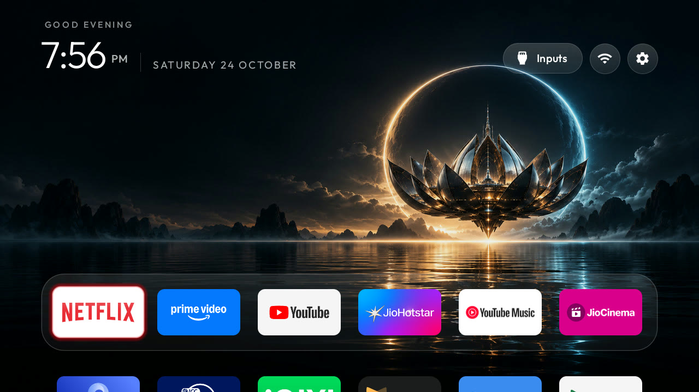

# v0: working TCL G13 baseline

This personal fork captures the working setup confirmed on 24 October 2026. The `v0` Git tag pins its source, launcher configuration, theme, artwork, and screenshot. Future experiments can be compared against this baseline.



## Device and interface

Tested on a TCL G13 / G13_2K_GB board, Google TV 14, firmware `UKN2.241110.001`. The device reports a 1280 x 720 display at 60 Hz and about 954 MB of RAM.

[Orbit Studio](themes/orbit-studio/README.md) preserves the wallpaper's contrast as selection moves. App colors appear around the focused tile. Highlight movement, tile zoom, and scrolling are animated without overshoot; the global color wash and advanced effects are off.

The dock order is Netflix, Prime Video, YouTube, JioHotstar, YouTube Music, and JioCinema. Down opens the rest of the TV-app grid, including Proton VPN. Inputs, Wi-Fi, and Settings are available in the header. The optional all-apps library is off because this firmware exposes maintenance/demo activities through it.

The compiled `config.xml` carries the six-app dock and reduced-motion fallback. The theme overrides motion settings for the final v0 interface. Theme changes do not require rebuilding the APK.

## Apply or rebuild

Follow [PROMPT.md](PROMPT.md) for device discovery, backups, Wi-Fi ownership checks, and safe Home handover. This snapshot is specific to this board and firmware; it is not a bulk debloat list for other TVs.

With CleanYourTV installed, run from this repository on Windows:

```powershell
$tvIp = '192.168.1.50' # replace with your TV address
$env:TV_PORT = '5555'
.\tools\theme.ps1 -TvHost $tvIp .\themes\orbit-studio
```

For launcher source/configuration changes, use [launcher/build-and-install.ps1](launcher/build-and-install.ps1) with JDK 17 and Android SDK platform/build-tools 34. To rebuild while CleanYourTV already owns Home:

```powershell
.\launcher\build-and-install.ps1 -TvHost $tvIp -StockLauncher none
.\tools\theme.ps1 -TvHost $tvIp .\themes\orbit-studio
```

No APK or prebuilt executable is included in this release.

## Recorded package state

The disabled packages for user 0 on this TV are `com.tcl.logkit`, `com.google.android.tungsten.setupwraith`, and `com.google.android.apps.tv.launcherx`. All remain installed. CleanYourTV is the default Home.

The setup wizard was disabled only after the repository's Wi-Fi ownership check passed. The stock launcher was disabled by the repository installer after the replacement started successfully. The recovery record and original handover list are retained locally.

The TCL input/quick panel (`com.tcl.suspension`), message box (`com.tcl.messagebox`), and firmware updater (`com.tcl.ttvs`) remain enabled. Streaming apps, Proton VPN, mirroring, HDMI, Wi-Fi, core Android services, keyboard, Play Store, and Play Services were preserved.

## Restore

Use the original handover list at its original local path: the recovery record is keyed to that path and the TV address. Keep the record under `~/.cleanyourtv/` with the private backups.

```powershell
$handoverList = 'C:\path\to\tv-home-handover.txt'
.\tools\restore.ps1 -TvHost $tvIp -List $handoverList -Stock 'com.google.android.apps.tv.launcherx'
```

The direct stock-Home fallback is:

```powershell
adb shell pm enable --user 0 com.google.android.tungsten.setupwraith
adb shell pm enable --user 0 com.google.android.apps.tv.launcherx
adb shell cmd package set-home-activity --user 0 com.google.android.apps.tv.launcherx/.home.HomeActivity
```

Logkit has its own local undo commands. Re-enabling packages does not restore forgotten Wi-Fi credentials; those networks must be joined again with their passwords.

## Validation and local data

The final UI was inspected on the real TV. Home resolution, focused activity, theme persistence, Wi-Fi reconnection, and disabled package state were checked after reboot. The owner confirmed the setup works. A short navigation sample recorded one janky frame out of 116; this is a smoke check, not a general performance benchmark.

Publication checks passed: 35 theme/configuration tests, Android release unit tests, lint, release assembly, and the APK size limit (488,511 bytes, below 491,520). The full 837-test Python suite was also attempted on native Windows and did not pass; its failures include unavailable WSL Bash, Unix symlink privileges, Windows temporary-file locking, and Linux virtual-environment paths. No tests or safety checks were weakened to accommodate that environment.

Backups, network names and credentials, ADB keys, local recovery records, temporary screenshots, SDK/JDK installations, and build outputs are excluded from this snapshot. The committed screenshot shows no account avatar, Wi-Fi name, IP address, or device identifiers.

After final adjustments, disable USB and Network/Wireless debugging, revoke debugging authorizations, and reboot. Verify the port is closed with `tools/adb-closed.py` as described in the main README.
